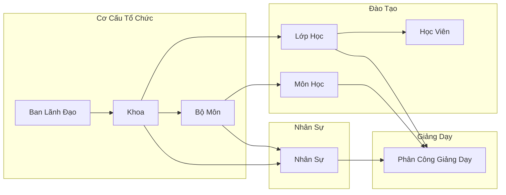

# BÁO CÁO TỔNG HỢP TOÀN DIỆN DỰ ÁN QUẢN LÝ ĐÀO TẠO (.NET 8 MVC)

---

## 1. BỐI CẢNH DỰ ÁN VÀ QUYẾT ĐỊNH KIẾN TRÚC

### 1.1. Bối cảnh triển khai
- **Thư mục làm việc**: `C:\Users\GIGABYTE G5 KD\Desktop\Code\LTMT3`
- **Mục tiêu**: Xây dựng mới hoàn toàn giải pháp Quản lý Tổ chức Đào tạo, Hồ sơ Cán bộ & Giảng viên, Khoa, Bộ môn, Lớp học, Học viên, Phân công giảng dạy, Kiểm toán hệ thống và giải pháp Nhập/Xuất Excel chuyên nghiệp theo yêu cầu chỉ đạo trực tiếp từ người dùng.
- **Nền tảng công nghệ**:
  - Target Framework: `net8.0` (C# 12, ASP.NET Core MVC).
  - SDK: .NET SDK `10.0.401`.
  - Cơ sở dữ liệu: Entity Framework Core SQLite `8.0.11` kèm EF Core Tools & Design.
  - Xử lý tệp bảng tính: ClosedXML `0.104.2`.
  - Xác thực & Phân quyền: ASP.NET Core Identity EntityFrameworkCore `8.0.11`.
  - Giao diện: Bootstrap 5.1 (tài nguyên local tại `wwwroot/lib/bootstrap/dist/`), Bootstrap Icons.
  - Kiểm thử: xUnit `2.5.3`, EF Core InMemory `8.0.11`, Microsoft.AspNetCore.Mvc.Testing `8.0.11`.

### 1.2. Kiến trúc hệ thống (3-Tier Architecture)
Hệ thống tuân thủ nghiêm ngặt mô hình phẳng thực dụng 3 tầng:
```
[Giao diện Người dùng (Razor Views / Bootstrap 5)]
                       │
                       ▼
       [Controllers (Tầng Điều Khiển MVC)]
                       │
                       ▼
    [Services (Tầng Nghiệp Vụ - Business Logic & Validation)]
                       │
                       ▼
     [Data / DbContext (Tầng Dữ Liệu - EF Core SQLite)]
```
- **Quy tắc phụ thuộc**: Controller tuyệt đối không truy vấn cơ sở dữ liệu trực tiếp; mọi thao tác tra cứu, thẩm định nghiệp vụ, kiểm tra ràng buộc toàn vẹn và biến đổi dữ liệu đều được thực hiện qua các Service thông qua Interface bắt đầu bằng tiền tố `I`.
- **Nguyên tắc SOLID**: Tách biệt trách nhiệm giữa UI, Service, File Helper và Data Access. Sử dụng Dependency Injection (DI) xuyên suốt trong `Program.cs`.

### 1.3. Quy chuẩn đặt tên bắt buộc (Tuân thủ `AGENTS.md`)
1. **Thành phần giao diện (HTML IDs / UI Controls)**: Cú pháp `tiềnTố` + `TênChứcNăng` (camelCase Tiếng Việt):
   - `btn`: `btnThemKhoa`, `btnThemNhanSu`, `btnNhapExcel`, `btnXuatExcel`, `btnTaiMauExcel`, `btnDangNhap`, `btnLuuKhoa`, `btnCapNhatKhoa`.
   - `txt`: `txtMaKhoa`, `txtTenKhoa`, `txtTimKiem`, `txtEmail`, `txtMatKhau`, `txtMaNhanSu`, `txtHoVaTen`.
   - `cbo`: `cboChonKhoa`, `cboChonBoMon`, `cboChonChucVu`, `cboNienKhoa`, `cboLocTrangThai`.
   - `dgv`: `dgvDanhSachKhoa`, `dgvDanhSachLop`, `dgvDanhSachNhanSu`, `dgvXemTruocDuLieu`, `dgvDanhSachLoiChiTiet`.
   - `pnl`: `pnlDanhSachKhoa`, `pnlChiTietNhanSu`, `pnlNhapExcel`, `pnlXemTruocPreview`, `pnlCayToChuc`, `pnlDashboard`.
   - `lbl`: `lblTieuDe`, `lblTongSoKhoa`, `lblThongKeTongSo`, `lblThongBaoLoi`, `lblThongBaoThanhCong`.
2. **Mã nguồn C#**:
   - Class/Struct/Enum: PascalCase Tiếng Việt danh từ (`Khoa`, `BoMon`, `LopHoc`, `HocVien`, `NhanSu`, `MonHoc`, `PhanCongGiangDay`, `NhatKyHeThong`, `TaiKhoan`, `VaiTro`).
   - Interface: `I` + PascalCase Tiếng Việt (`IKhoaDichVu`, `IBoMonDichVu`, `ILopHocDichVu`, `IHocVienDichVu`, `INhanSuDichVu`, `IExcelDichVu`, `INhatKyDichVu`).
   - Phương thức (Methods): PascalCase bắt đầu bằng động từ Tiếng Việt (`ThemKhoaAsync`, `CapNhatKhoaAsync`, `XoaKhoaAsync`, `LayDanhSachAsync`, `TaoTepMauExcel`, `CommitDuLieuExcelAsync`).
   - Biến Boolean: Bắt đầu bằng `Co`, `La`, `Da` (`CoHoatDong`, `LaChuNhiem`, `LaHopLe`, `CoTheXoa`).
   - Biến nội bộ (Private fields): `_` + camelCase Tiếng Việt (`_coSoDuLieu`, `_nhatKyDichVu`, `_excelDichVu`).
   - XML Documentation (`/// <summary>`): Viết đầy đủ cho mọi class, interface, method và property public.
   - Khối lệnh: Mọi lệnh `if`, `else`, `for`, `while` bắt buộc dùng cặp ngoặc `{}`. Tài nguyên `IDisposable` luôn giải phóng bằng `using`.

---

## 2. THIẾT KẾ CƠ SỞ DỮ LIỆU & ENTITY MODEL

### 2.1. Danh mục các bảng dữ liệu (Tables)
Cơ sở dữ liệu SQLite được tạo lập qua migration `20261009034732_KhoiTaoHeThong`:

```
┌────────────────────────────────────────────────────────────────────────┐
│                        QUANLYDAOTAO DATABASE                           │
├────────────────────┬───────────────────────────────────────────────────┤
│ Bảng               │ Chức năng & Mô tả                                │
├────────────────────┼───────────────────────────────────────────────────┤
│ Khoas              │ Khoa đào tạo                                      │
│ BoMons             │ Bộ môn trực thuộc Khoa                            │
│ LopHocs            │ Lớp học đào tạo theo niên khóa                    │
│ HocViens           │ Học viên theo lớp                                 │
│ NhanSus            │ Hồ sơ cán bộ & giảng viên (7 nhóm trường A-G)    │
│ ChucVus            │ Danh mục chức vụ công tác                         │
│ TrinhDoChuyenMons  │ Danh mục trình độ chuyên môn                      │
│ MonHocs            │ Môn học đào tạo (tín chỉ, lý thuyết, thực hành)   │
│ PhanCongGiangDays  │ Phân công giảng dạy (Giảng viên, Môn, Lớp, Học kỳ)│
│ NhatKyHeThongs     │ Nhật ký kiểm toán (người dùng, hành động, IP, log)│
│ AspNetUsers        │ Tài khoản người dùng (TaiKhoan kế thừa Identity)  │
│ AspNetRoles        │ Vai trò phân quyền (VaiTro kế thừa IdentityRole)  │
│ AspNetUserRoles    │ Bảng nối tài khoản và vai trò                     │
└────────────────────┴───────────────────────────────────────────────────┘
```

### 2.2. Tính toàn vẹn và Ràng buộc dữ liệu
- **Chỉ mục duy nhất (Unique Index)**: Được đặt trên toàn bộ các mã nghiệp vụ: `MaKhoa`, `MaBoMon`, `MaLop`, `MaHocVien`, `MaNhanSu`, `MaChucVu`, `MaTrinhDo`, `MaMonHoc`, `MaPhanCong`.
- **Chỉ mục tìm kiếm (Search Indexes)**: Đặt trên `TenKhoa`, `TenLop`, `NienKhoa`, `HoVaTen`, `EmailCongViec`, `ThoiDiem` của nhật ký.
- **Bảo vệ toàn vẹn dữ liệu cha - con**: Toàn bộ quan hệ ngoại vi đều cấu hình `OnDelete(DeleteBehavior.Restrict)`. Hệ thống ngăn chặn xóa dây chuyền (Cascade Delete), bảo vệ dữ liệu con không bị xóa ngầm ngoài ý muốn.

---

## 3. CÁC MODULE CHỨC NĂNG NGHIỆP VỤ ĐÃ HOÀN THIỆN



### 3.1. Bảng điều khiển tổng quan (Dashboard - `HomeController`)
- Thống kê tự động các chỉ số: Tổng số Khoa, Bộ môn, Lớp học, Học viên, Nhân sự, Môn học.
- Khung thao tác nhanh (Quick Action Buttons): Thêm mới hồ sơ, thêm khoa, mở nhanh cây tổ chức, nhập Excel.
- Nhật ký hoạt động gần đây hiển thị 10 thao tác kiểm toán mới nhất trong thời gian thực.

### 3.2. Cây tổ chức trực quan (`CayToChucController`)
- Hiển thị cây phân cấp đa tầng từ Ban Lãnh Đạo / Ban Giám Hiệu $\rightarrow$ Khoa $\rightarrow$ Bộ Môn / Lớp Học $\rightarrow$ Cán bộ & Học viên.
- Cơ chế Accordion lồng nhau với các nút **Mở Rộng Tất Cả** / **Thu Gọn Tất Cả** được viết bằng JavaScript/Bootstrap DOM, cho phép xem sĩ số, chuyên môn và liên kết xem chi tiết của từng mắt xích.

### 3.3. Module Khoa & Bộ môn (`KhoaController`, `BoMonController`)
- CRUD thủ công với giao diện bảng, tìm kiếm từ khóa và lọc trạng thái hoạt động.
- Trang chi tiết hiển thị thẻ thông tin đơn vị kèm 3 tab con trực thuộc: Bộ môn, Lớp học, Nhân sự.
- Kiểm tra tính hợp lệ trước khi xóa: Nếu đơn vị cha còn dữ liệu con phụ thuộc, hệ thống từ chối xóa và hiển thị thông báo giải thích cụ thể bằng Tiếng Việt.

### 3.4. Module Lớp học & Học viên (`LopHocController`, `HocVienController`)
- Quản lý lớp học gắn với niên khóa đào tạo và chỉ tiêu sĩ số tối đa.
- Thanh tiến độ (Progress bar) tự động đổi màu cảnh báo khi lớp sắp đầy sĩ số ($>80\%$) hoặc đã đạt giới hạn ($100\%$).
- Quản lý học viên với đầy đủ mã học viên duy nhất, ngày sinh, giới tính, email, số điện thoại, địa chỉ cư trú và phân lớp.

### 3.5. Module Hồ sơ Nhân sự Toàn diện (`NhanSuController`)
Hồ sơ nhân sự gồm đầy đủ 7 nhóm trường chuyên nghiệp:
- **Nhóm A**: Mã nhân sự (giữ số 0 đầu), trạng thái hồ sơ, ảnh đại diện.
- **Nhóm B**: Họ tên, ngày sinh, giới tính, quốc tịch, dân tộc, tình trạng hôn nhân.
- **Nhóm C**: Loại giấy tờ định danh (CCCD/Hộ chiếu), số giấy tờ, ngày cấp, nơi cấp, số điện thoại, email công việc (bắt buộc & duy nhất), email cá nhân, địa chỉ thường trú, địa chỉ liên hệ hiện tại, người và SĐT liên hệ khẩn cấp.
- **Nhóm D**: Khoa, bộ môn, chức vụ, chức danh nghề nghiệp, người quản lý trực tiếp, ngày vào làm, loại hợp đồng, thời hạn hợp đồng, trạng thái công tác (Đang làm việc, Tạm nghỉ, Đã nghỉ việc).
- **Nhóm E**: Trình độ chuyên môn, trình độ học vấn, chuyên ngành, trường đào tạo, học vị, học hàm, lĩnh vực chuyên môn, kinh nghiệm công tác, ghi chú chuyên môn.
- **Nhóm F**: Danh sách phân công đào tạo (môn học phụ trách, lớp phụ trách, học kỳ, năm học, vai trò giảng dạy, chủ nhiệm).
- **Nhóm G**: Quản trị hồ sơ (ngày tạo, ngày cập nhật, người tạo/cập nhật).

Trang chi tiết cán bộ thiết kế dạng **Profile Tabs** trực quan, đẹp mắt và tối ưu trên cả desktop lẫn thiết bị di động.

### 3.6. Module Môn học & Phân công giảng dạy (`MonHocController`, `PhanCongGiangDayController`)
- Quản lý môn học với cấu trúc số tín chỉ, số tiết lý thuyết, số tiết thực hành và bộ môn quản lý.
- Phân công giảng dạy gắn kết Nhân sự $\times$ Môn học $\times$ Lớp học $\times$ Học kỳ $\times$ Năm học, kèm vai trò giảng dạy (Giảng viên chính, Trợ giảng, Thực hành) và vai trò Chủ nhiệm lớp.

### 3.7. Module Quản trị Tài khoản & Phân quyền (`TaiKhoanController`)
- 3 vai trò người dùng chuẩn hóa:
  - `Admin`: Toàn quyền quản trị tài khoản, phân quyền, cấu hình hệ thống, xem nhật ký kiểm toán.
  - `DataManager`: Thực hiện CRUD dữ liệu nghiệp vụ, nhập/xuất Excel.
  - `Viewer`: Tra cứu, xem danh sách và chi tiết báo cáo.
- Tài khoản quản trị khởi tạo an toàn: `admin@quanlydaotao.local` (Mật khẩu: `Admin@123456`).
- Quản trị viên có chức năng tạo tài khoản mới, phân vai trò và Khóa / Mở khóa tài khoản ngay trên giao diện web.
- Tự bảo vệ: Quản trị viên không thể tự khóa tài khoản của chính mình.
- Người dùng có trang đổi mật khẩu cá nhân tự phục vụ.

### 3.8. Module Nhật ký kiểm toán (`NhatKyController`)
- Tự động ghi lại: Thời điểm UTC, người thực hiện, hành động (Thêm mới, Cập nhật, Xóa, Nhập Excel, Xuất Excel, Đăng nhập), bảng dữ liệu bị tác động, khóa bản ghi, tóm tắt thay đổi và địa chỉ IP gửi request.
- Giao diện tra cứu bộ lọc theo người dùng, bảng dữ liệu và từ khóa dành riêng cho cấp quản trị.

---

## 4. HỆ THỐNG NHẬP / XUẤT EXCEL CHUYÊN NGHIỆP

Tính năng Excel được thiết kế và thực thi là **trọng tâm ưu tiên cao nhất** của dự án (`ExcelDichVu.cs`, `ExcelController.cs`):

```
┌────────────────────────────────────────────────────────────────────────┐
│                        QUY TRÌNH NHẬP EXCEL 5 BƯỚC                     │
├────────────────────────────────────────────────────────────────────────┤
│ Bước 1: Người dùng tải tệp mẫu chuẩn do hệ thống sinh ra (.xlsx)       │
│ Bước 2: Tải tệp dữ liệu lên qua giao diện web                         │
│ Bước 3: Thẩm định nghiêm ngặt Header và Data (Strict Validation)       │
│ Bước 4: Xem trước (Preview) với thống kê dòng hợp lệ / dòng lỗi       │
│ Bước 5: Xác nhận Commit trong Database Transaction an toàn             │
└────────────────────────────────────────────────────────────────────────┘
```

### 4.1. Tải tệp mẫu (Template Generation)
- Tên sheet được xác định rõ theo từng module (`Mau_Khoa`, `Mau_NhanSu`, ...).
- **Dòng 1**: Header chuẩn, in đậm, nền xanh chuyên nghiệp.
- **Dòng 2**: Hướng dẫn trường bắt buộc / tùy chọn và mô tả định dạng mong đợi.
- **Dòng 3**: Dữ liệu mẫu (Ví dụ hợp lệ).
- Khóa ngoại tham chiếu bằng mã nghiệp vụ thực tế, không dùng ID database nội bộ.

### 4.2. Kiểm tra Header trước khi nhập (Header Validation)
- So khớp nghiêm ngặt theo schema và danh sách alias được định nghĩa trước.
- **Thiếu header bắt buộc**: Báo lỗi cụ thể tên cột bị thiếu (`ERR_MISSING_REQUIRED_HEADER`).
- **Header trùng lặp**: Phát hiện và báo lỗi cột trùng (`ERR_DUPLICATE_HEADER`).
- **Header không xác định**: Phát hiện cột lạ không thuộc lược đồ (`ERR_UNKNOWN_HEADER`), không âm thầm nuốt hoặc bỏ qua.
- Hỗ trợ đổi thứ tự các cột mà vẫn nhận diện và ánh xạ chính xác về đúng trường dữ liệu.

### 4.3. Kiểm tra kiểu dữ liệu, định dạng và ràng buộc nghiệp vụ (Data Validation)
- **Bảo toàn số 0 đầu trong mã**: Đọc cell dạng raw text, không chuyển đổi tự động sang số làm mất số 0 đầu (ví dụ: mã `00123`, CCCD `001188000123`).
- **Định dạng ngày tháng**: Thẩm định chặt chẽ theo format `dd/MM/yyyy`, từ chối ngày tháng không hợp lệ như `32/15/2005` (`ERR_INVALID_DATE_FORMAT`).
- **Định dạng email**: Thẩm định qua Regex và MailAddress, từ chối email lỗi như `abc@` (`ERR_INVALID_EMAIL_FORMAT`).
- **Trường bắt buộc trống**: Gắn cờ lỗi `ERR_REQUIRED_FIELD_EMPTY`.
- **Trùng lặp mã trong file**: Phát hiện và báo lỗi ngay trên các dòng trùng lặp tiếp theo (`ERR_DUPLICATE_KEY_IN_FILE`).
- **Trùng lặp mã trong database**: Đối chiếu với cơ sở dữ liệu hiện có để chống ghi đè (`ERR_DUPLICATE_KEY_IN_DB`).
- **Ràng buộc khóa ngoại**: Kiểm tra sự tồn tại của Mã khoa, Mã bộ môn, Mã lớp, Mã môn học, Mã chức vụ, Mã trình độ. Báo lỗi `ERR_FOREIGN_KEY_NOT_FOUND` kèm tên mã đối tượng cha còn thiếu.
- **Báo lỗi toàn diện**: Một dòng có nhiều lỗi sẽ ghi nhận và báo cáo tất cả các lỗi trên dòng đó, không dừng lại ở lỗi đầu tiên.

### 4.4. Màn hình Xem trước (Preview) & Báo cáo lỗi chi tiết
- Thống kê 3 chỉ số lớn: Tổng số dòng, Dòng hợp lệ, Dòng lỗi.
- Bảng chi tiết lỗi: Số dòng, Tên trường, Địa chỉ ô (ví dụ: `B4`), Giá trị nhập, Mã lỗi, Mô tả lỗi Tiếng Việt, Hướng dẫn khắc phục.
- Nút **"Tải Báo Cáo Lỗi Excel"**: Xuất file Excel báo cáo lỗi định dạng đẹp mắt để người dùng tải về sửa chữa.
- Bảng Preview: Hiển thị toàn bộ dữ liệu đọc được, dòng hợp lệ đánh dấu huy hiệu xanh, dòng lỗi tô màu nền đỏ và liệt kê các nguyên nhân lỗi.

### 4.5. Xác nhận Commit trong Database Transaction
- Phiên xem trước được quản lý an toàn trong bộ nhớ máy chủ (`ConcurrentDictionary<string, PhienPreviewExcel>`) với mã phiên GUID và thời hạn hiệu lực 30 phút.
- Khi người dùng xác nhận, dữ liệu được ghi vào cơ sở dữ liệu trong một **Database Transaction**. Nếu phát sinh lỗi bất ngờ trong quá trình lưu, toàn bộ lô dữ liệu sẽ được **Rollback** sạch sẽ, không để lại dữ liệu dở dang.

### 4.6. Xuất dữ liệu & Phòng chống Formula Injection
- Chức năng xuất Excel có sẵn cho toàn bộ các module.
- **Bảo vệ chống CSV / Formula Injection**: Khi xuất dữ liệu ra Excel, mọi chuỗi bắt đầu bằng ký tự nguy hiểm (`=`, `+`, `-`, `@`) đều được tự động xử lý tiền tố an toàn, ngăn chặn việc Excel tự ý thực thi mã độc hoặc công thức độc hại khi người dùng mở tệp.
- Giới hạn bảo vệ tài nguyên: Giới hạn dung lượng tệp tải lên tối đa 5 MB, giới hạn số dòng dữ liệu tối đa 1000 dòng.

---

## 5. BẰNG CHỨNG KIỂM THỬ THỰC TẾ

### 5.1. Kết quả kiểm thử tự động xUnit (79/79 Tests Pass)
Bộ test tự động được tổ chức chặt chẽ theo 5 nhóm kiểm thử trong `QuanLyDaoTao.Tests`:

```text
Test run for C:\Users\GIGABYTE G5 KD\Desktop\Code\LTMT3\QuanLyDaoTao.Tests\bin\Debug\net8.0\QuanLyDaoTao.Tests.dll (.NETCoreApp,Version=v8.0)
A total of 1 test files matched the specified pattern.

Passed!  - Failed: 0, Passed: 79, Skipped: 0, Total: 79, Duration: 2 s - QuanLyDaoTao.Tests.dll (net8.0)
```

**Chi tiết các nhóm test:**
- **Nhóm A (Database & Business Logic)**: 28 tests cho CRUD, tính duy nhất của mã, kiểm tra khóa ngoại, kiểm tra điều kiện xóa cha - con trên `KhoaDichVu`, `BoMonDichVu`, `LopHocDichVu`, `HocVienDichVu`, `NhanSuDichVu`, `MonHocDichVu`, `PhanCongGiangDayDichVu`, `ChucVuDichVu`, `TrinhDoChuyenMonDichVu`.
- **Nhóm B (Header Excel Validation)**: 5 tests kiểm tra file đúng mẫu, đổi thứ tự cột, thiếu cột bắt buộc, trùng cột tiêu đề, cột lạ không xác định.
- **Nhóm C (Data Format & Business Constraints)**: 8 tests kiểm tra ngày sinh sai, email sai, trường bắt buộc trống, trùng mã trong file, trùng mã trong DB, khóa ngoại không tồn tại, bảo toàn số 0 đầu, báo nhiều lỗi trên 1 dòng.
- **Nhóm D (Preview & Transaction Integrity)**: 3 tests kiểm tra bước preview không làm biến đổi DB, bước commit lưu chính xác, quản lý phiên preview có thời hạn.
- **Nhóm E (Security & Resource Limits)**: 2 tests kiểm tra phòng chống Formula Injection khi xuất file và từ chối tệp vượt quá 1000 dòng dữ liệu.
- **Nhóm Controller & Integration**: 33 tests kiểm tra logic Controller và chạy trực tiếp đường ống HTTP request của ứng dụng qua `WebApplicationFactory<Program>`.

### 5.2. Kết quả kiểm tra biên dịch nghiêm ngặt
```powershell
dotnet build --warnaserror
```
**Kết quả**: `Build succeeded. 0 Warning(s), 0 Error(s)`.

### 5.3. Kết quả kiểm tra HTTP Smoke Test trên máy chủ thật
Khởi chạy máy chủ nội bộ trên cổng `5219`, toàn bộ 14 endpoint chủ chốt phản hồi thành công:
```text
[SUCCESS] http://127.0.0.1:5219/                           -> Status: 200, Content-Type: text/html, Length: 17253
[SUCCESS] http://127.0.0.1:5219/TaiKhoan/DangNhap          -> Status: 200, Content-Type: text/html, Length: 11427
[SUCCESS] http://127.0.0.1:5219/Khoa                       -> Status: 200, Content-Type: text/html, Length: 15994
[SUCCESS] http://127.0.0.1:5219/BoMon                      -> Status: 200, Content-Type: text/html, Length: 16340
[SUCCESS] http://127.0.0.1:5219/LopHoc                     -> Status: 200, Content-Type: text/html, Length: 16549
[SUCCESS] http://127.0.0.1:5219/HocVien                    -> Status: 200, Content-Type: text/html, Length: 12183
[SUCCESS] http://127.0.0.1:5219/NhanSu                     -> Status: 200, Content-Type: text/html, Length: 13051
[SUCCESS] http://127.0.0.1:5219/CayToChuc                  -> Status: 200, Content-Type: text/html, Length: 25447
[SUCCESS] http://127.0.0.1:5219/ChucVu                     -> Status: 200, Content-Type: text/html, Length: 15663
[SUCCESS] http://127.0.0.1:5219/TrinhDoChuyenMon           -> Status: 200, Content-Type: text/html, Length: 14618
[SUCCESS] http://127.0.0.1:5219/MonHoc                     -> Status: 200, Content-Type: text/html, Length: 16257
[SUCCESS] http://127.0.0.1:5219/PhanCongGiangDay           -> Status: 200, Content-Type: text/html, Length: 12330
[SUCCESS] http://127.0.0.1:5219/Excel/TaiTepMau?module=Khoa   -> Status: 200, Content-Type: application/vnd.openxmlformats-officedocument.spreadsheetml.sheet, Length: 7032
[SUCCESS] http://127.0.0.1:5219/Excel/TaiTepMau?module=NhanSu -> Status: 200, Content-Type: application/vnd.openxmlformats-officedocument.spreadsheetml.sheet, Length: 7277
```

---

## 6. HƯỚNG DẪN KHỞI CHẠY VÀ VẬN HÀNH DỰ ÁN

### 6.1. Khởi chạy bằng PowerShell / Terminal
```powershell
# Chuyển vào thư mục mã nguồn
cd "C:\Users\GIGABYTE G5 KD\Desktop\Code\LTMT3"

# Chạy toàn bộ 79 bài test
dotnet test

# Khởi chạy ứng dụng web
dotnet run --project QuanLyDaoTao/QuanLyDaoTao.csproj
```
Ứng dụng sẽ tự động kích hoạt trên trình duyệt tại địa chỉ `http://localhost:5000` hoặc cổng hiển thị trong màn hình console.

### 6.2. Mở dự án trong Visual Studio 2022
1. Khởi động Visual Studio và chọn **Open a project or solution**.
2. Chọn tệp giải pháp: `C:\Users\GIGABYTE G5 KD\Desktop\Code\LTMT3\QuanLyDaoTao.sln`.
3. Chuột phải vào project `QuanLyDaoTao`, chọn **Set as Startup Project**.
4. Nhấn phím `F5` (Debug) hoặc `Ctrl + F5` (Run without debugging) để khởi chạy.

### 6.3. Tài khoản Quản trị viên khởi tạo ban đầu
- **Tài khoản**: `admin@quanlydaotao.local`
- **Mật khẩu**: `Admin@123456`
- **Vai trò**: `Admin` (Toàn quyền quản trị hệ thống)

### 6.4. Hướng dẫn Cloudflare Tunnel (Khi cần Public thử nghiệm)
1. Khởi chạy ứng dụng nội bộ:
   ```powershell
   dotnet run --project QuanLyDaoTao/QuanLyDaoTao.csproj --urls "http://127.0.0.1:5000"
   ```
2. Mở một cửa sổ PowerShell riêng biệt và tạo tunnel tạm thời (Quick Tunnel):
   ```powershell
   cloudflared tunnel --url http://127.0.0.1:5000
   ```
3. Cloudflare sẽ cấp một đường dẫn public có định dạng `https://<ngau-nhien>.trycloudflare.com` để truy cập từ xa mà không cần mở port modem.
*(Lưu ý tuân thủ quy tắc bảo mật: Không công khai cơ sở dữ liệu thật hoặc thông tin cá nhân thật qua tunnel công cộng).*
