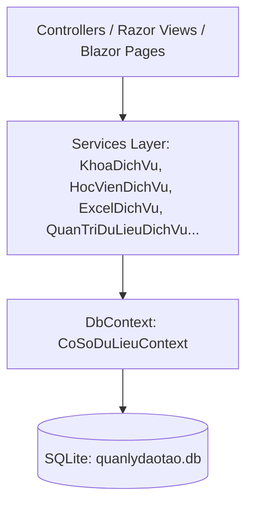
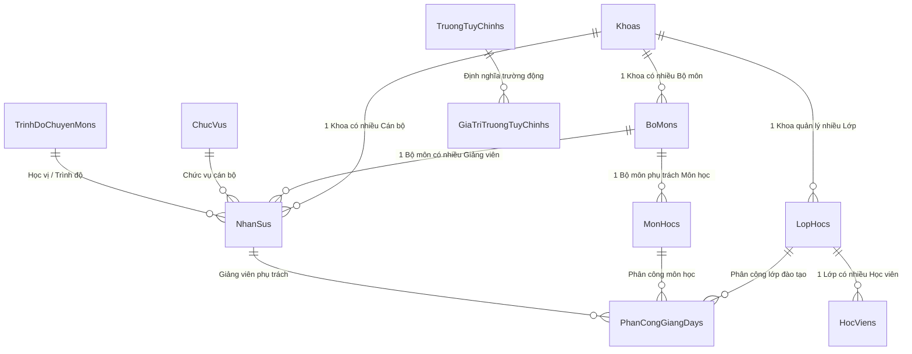
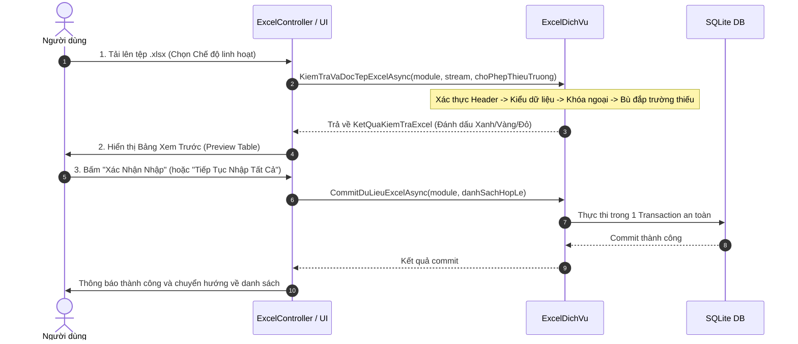

# TÀI LIỆU TỔNG HỢP KIẾN TRÚC, TÍNH NĂNG VÀ HƯỚNG DẪN DỰ ÁN QUANLYDAOTAO
> **Hệ thống Quản lý Khoa, Lớp Đào tạo & Hồ sơ Nhân sự - Học viện An ninh Nhân dân (C500)**  
> **Thời điểm cập nhật**: Tháng 11/2026 | **Phiên bản nền tảng**: .NET 8 LTS (ASP.NET Core MVC & Blazor)

---

## 1. TỔNG QUAN DỰ ÁN & TECH STACK

### 1.1. Mục tiêu Dự án
Xây dựng hệ thống quản lý phẳng (Pragmatic 3-Tier) phục vụ công tác đào tạo, quản lý tổ chức theo cây đơn vị, hồ sơ cán bộ/giảng viên, lớp đào tạo, học viên khóa D57, phân công giảng dạy, và đặc biệt là hệ thống Nhập/Xuất Excel chuyên nghiệp với tính năng kiểm tra lỗi từng ô (Cell-by-cell), bảng xem trước (Preview) và cơ chế bù đắp dữ liệu linh hoạt (Flexible/Tolerant Import).

### 1.2. Công nghệ Cốt lõi
- **Ngôn ngữ & Runtime**: C# 12, .NET 8.0 SDK (`net8.0`).
- **Giao diện Người dùng**: ASP.NET Core MVC (Razor Views) kết hợp Blazor Interactive Server Components cho các module cần phản hồi trực tiếp (Live CRUD, Inline Editing).
- **Cơ sở Dữ liệu**: SQLite 3 qua Entity Framework Core 8.0 (`Microsoft.EntityFrameworkCore.Sqlite` 8.0.11), tương thích hoàn toàn môi trường Server và Container.
- **Xử lý Tệp Excel**: ClosedXML (`ClosedXML` 0.105.1) + OpenXML, tối ưu hóa tài nguyên (MemoryStream dispose, streaming đọc/ghi an toàn).
- **Xác thực & Phân quyền**: ASP.NET Core Identity tích hợp (RBAC - Role-Based Access Control) với bảng phân quyền người dùng, Cookie Authentication an toàn và AntiForgery Token.
- **Kiểm thử**: xUnit (`151/151 tests pass 100%`), `Microsoft.AspNetCore.Mvc.Testing` (Integration Tests).
- **CSS / UI Controls**: Bootstrap 5.1.0 (local asset, không phụ thuộc CDN bên ngoài), Bootstrap Icons 1.11.3.

---

## 2. NGUYÊN TẮC THIẾT KẾ & QUY CHUẨN ĐẶT TÊN (AGENTS.MD)

### 2.1. Kiến trúc 3 Tầng Thực dụng

- **Controller / UI**: Chỉ tiếp nhận request, gọi Service qua Interface (Dependency Inversion), trả về ViewModel / View. Tuyệt đối không query `DbContext` trực tiếp trong Controller.
- **Service**: Đảm nhiệm validation nghiệp vụ, xử lý quan hệ logic, transaction và lưu dữ liệu.
- **Data (DbContext)**: Lưu trữ mô hình thực thể và cấu hình quan hệ ORM.

### 2.2. Quy chuẩn Đặt tên Bắt buộc (Code Standards)
- **UI Elements ID**: `tiềnTố` + `TênChứcNăng` (camelCase Tiếng Việt):
  - `btn`: Nút bấm (`btnThemKhoa`, `btnXoaLop`, `btnNhapExcel`, `btnXacNhanCommit`).
  - `txt`: Ô nhập văn bản (`txtMaHocVien`, `txtHoVaTen`, `txtEmail`, `txtMatKhau`).
  - `lbl`: Nhãn văn bản (`lblTieuDe`, `lblThongBaoLoi`, `lblThongKeHopLe`).
  - `pnl`: Khung chứa/Card (`pnlDanhSachKhoa`, `pnlBangDuLieu`, `pnlXemTruocPreview`).
  - `cbo`: Hộp chọn thả xuống (`cboChonKhoa`, `cboNienKhoa`).
  - `dgv`: Bảng dữ liệu (`dgvDanhSachHocVien`, `dgvDanhSachLop`, `dgvXemTruocDuLieu`).
- **Mã nguồn C#**:
  - Class, Struct, Enum, Interface, Property, Method: **PascalCase Tiếng Việt không dấu** (`Khoa.cs`, `HocVienDichVu.cs`, `IKhoaDichVu.cs`, `ThemHocVienAsync()`).
  - Interface: Luôn có tiền tố `I` (`IHocVienDichVu`, `IExcelDichVu`, `IQuanTriDuLieuDichVu`).
  - Private Fields: `_` + camelCase (`_coSoDuLieu`, `_excelDichVu`).
  - Biến Boolean: Bắt đầu bằng `Co`, `La`, `Da` (`CoHoatDong`, `LaHopLe`, `LaChuNhiem`).
  - Guard Clauses: Dùng `ArgumentNullException.ThrowIfNull` kiểm tra tham số đầu vào.
  - Khối lệnh: Mọi nhánh `if`, `else`, `for`, `while` bắt buộc có dấu ngoặc `{}`. Không nuốt Exception bằng `catch (Exception)` rỗng.

---

## 3. CƠ SỞ DỮ LIỆU & CẤU TRÚC ENTITY

Database SQLite được quản lý tại `QuanLyDaoTao/quanlydaotao.db` với các nhóm bảng:



### 3.1. Các Entity Nghiệp vụ Chính
1. **`Khoa`**: `KhoaId`, `MaKhoa` (Unique), `TenKhoa`, `MoTa`, `SoDienThoai`, `Email`, `DiaDiem`, `CoHoatDong`, `NgayTao`.
2. **`BoMon`**: `BoMonId`, `MaBoMon` (Unique), `TenBoMon`, `MoTa`, `KhoaId` (FK), `CoHoatDong`, `NgayTao`.
3. **`LopHoc`**: `LopHocId`, `MaLop` (Unique), `TenLop`, `NienKhoa`, `KhoaId` (FK), `SoLuongToiDa`, `CoHoatDong`, `NgayTao`.
4. **`HocVien`**: `HocVienId`, `MaHocVien` (Unique), `HoVaTen`, `NgaySinh`, `GioiTinh`, `Email`, `SoDienThoai`, `DiaChi`, `LopHocId` (FK), `TrangThai`, `NgayTao`.
5. **`NhanSu`**: `NhanSuId`, `MaNhanSu` (Unique), `HoVaTen`, `NgaySinh`, `GioiTinh`, `SoCCCD`, `Email`, `SoDienThoai`, `DiaChi`, `KhoaId` (FK), `BoMonId` (FK), `ChucVuId` (FK), `TrinhDoChuyenMonId` (FK), `ChuyenMonDaoTao`, `TrangThai`, `GhiChu`, `NgayTao`.
6. **`MonHoc`**: `MonHocId`, `MaMonHoc` (Unique), `TenMonHoc`, `SoTinChi`, `SoTietLyThuyet`, `SoTietThucHanh`, `BoMonId` (FK), `CoHoatDong`.
7. **`PhanCongGiangDay`**: `PhanCongId`, `MaPhanCong` (Unique), `NhanSuId` (FK), `MonHocId` (FK), `LopHocId` (FK), `HocKyNamHoc`, `VaiTroGiangDay`, `LaChuNhiem`, `GhiChu`.

### 3.2. Nhóm Bảng Mở Rộng & Kiểm Toán
8. **`TruongTuyChinhs` & `GiaTriTruongTuyChinhs`**: Động cơ **Dynamic Custom Fields Engine** cho phép thêm các trường dữ liệu tùy biến theo thời gian thực (như `DanToc`, `ChucVu` cho Học Viên; `Sat_nhap` cho Khoa; `Chuyen_giao` cho Bộ Môn; `ChungChi` cho Nhân Sự) mà không cần can thiệp migration cơ sở dữ liệu.
9. **`NhatKyHeThongs`**: Nhật ký Audit Trail ghi lại mọi hoạt động thêm/sửa/xóa, địa chỉ IP, người thực hiện, thời điểm và thay đổi dữ liệu cũ -> mới.
10. **`AspNetUsers`, `AspNetRoles`, `AspNetUserRoles`**: Nhóm bảng Identity quản lý người dùng và phân quyền.

---

## 4. HỆ THỐNG PHÂN QUYỀN CHUẨN HÓA 3 VAI TRÒ (RBAC)

Hệ thống đã được quy hoạch gọn gàng thành **3 vai trò chuẩn mực**:
1. **`SuperAdmin` ("Superadmin")**: Có toàn quyền tối cao trong hệ thống. Độc quyền Live CRUD Database Studio, quản lý tài khoản, phân quyền, cấu hình hệ thống và thực hiện mọi thao tác thêm/sửa/xóa.
2. **`GiaoVien` ("GiaoVien")**: Giáo viên / Giảng viên / Cán bộ đào tạo. Có toàn quyền quản lý nghiệp vụ: Nhập / Xuất / Sửa / Xóa với Excel, quản lý Bộ môn, Khoa, Lớp học, Học viên, Môn học và Phân công giảng dạy.
3. **`User` ("User" - `VaiTroMacDinh.NguoiDung`)**: Người dùng thông thường / Học viên. **Chỉ có chức năng Xem (Read-only)**. Hệ thống ẩn hoàn toàn mọi nút Thêm, Sửa, Xóa, Nhập Excel trên cả giao diện MVC Views lẫn Blazor Server Components.
### Tài khoản Mặc định Khởi tạo:
| Tài khoản Email | Vai trò | Mật khẩu mặc định | Mục đích sử dụng |
|---|---|---|---|
| `superadmin@quanlydaotao.local` | `SuperAdmin` | `Admin@123456` | Toàn quyền kiểm trị tối cao, Live CRUD Studio |
| `admin@quanlydaotao.local` | `QuanTriVien` | `Admin@123456` | Quản trị vận hành hệ thống |
| `giaovien@quanlydaotao.local` | `GiaoVien` | `Admin@123456` | Giảng viên đào tạo |
| `canbo@quanlydaotao.local` | `CanBo` | `Admin@123456` | Cán bộ giáo vụ |
| `user@quanlydaotao.local` | `NguoiDung` | `Admin@123456` | Học viên / Người dùng tra cứu |

---

## 5. TÍNH NĂNG NHẬP / XUẤT EXCEL CHUYÊN NGHIỆP

Đây là module trung tâm của dự án với các tiêu chuẩn an toàn cao cấp:



### 5.1. Nhận diện Tiêu đề & Ràng buộc Header
- Khớp tiêu đề cột nghiêm ngặt (hỗ trợ alias chuẩn hóa). Báo lỗi cụ thể khi thiếu header bắt buộc, thừa header lạ hoặc trùng header.
- Tự động bỏ qua khoảng trắng thừa, chuẩn hóa Unicode.

### 5.2. Chế độ Nhập Linh Hoạt (Flexible/Tolerant Import)
Được kích hoạt mặc định qua công tắc trên giao diện `NhapExcel.cshtml` hoặc khi bấm `Tiếp Tục Nhập Tất Cả` tại `XemTruocPreview.cshtml`:
- **Thiếu `Mã học viên` / `Mã nhân sự`**: Tự động sinh mã nghiệp vụ duy nhất (`HV_20261103_0001`, `CB_AUTOGEN_0001`).
- **Thiếu `Giới tính`**: Tự động suy luận giới tính dựa vào quy luật họ tên (tên đệm `Thị`, các tên nữ `Vân, Hân, Chi, Nhi, Thư, Yến, Ly, Trang, Huyền, Phượng...` -> `Nữ`, còn lại -> `Nam`).
- **Thiếu hoặc sai `Ngày sinh`**: Tự động phân tích nhiều định dạng ngày (`dd/MM/yyyy`, `d/M/yyyy`, `yyyy-MM-dd`); nếu thiếu -> bù đắp ngày chuẩn (`01/01/2007`).
- **Thiếu `Mã lớp` / `Mã khoa`**: Tự động liên kết tới bản ghi khả dụng trong CSDL qua cơ chế `TryGetValue` chống văng lỗi `KeyNotFoundException`.
- **Trùng mã nghiệp vụ**: Tự động sinh hậu tố phân biệt để bảo toàn hàng và tiếp tục nhập.

### 5.3. Bảng Xem Trước (Cell-by-cell Color Visuals)
- **Ô Xanh lá (`.excel-cell-valid`)**: Dữ liệu chuẩn mực, hoàn toàn hợp lệ.
- **Ô Vàng (`.excel-cell-warning`)**: Dữ liệu khuyết thiếu đã được hệ thống **Tự Động Bù Đắp** (kèm icon phép thuật `<i class="bi bi-magic"></i>` và tooltip giải thích).
- **Ô Đỏ (`.excel-cell-error`)**: Báo lỗi nghiêm trọng cần sửa nếu ở chế độ nghiêm ngặt.
- **Tải Báo Cáo Lỗi**: Cho phép xuất tệp Excel báo cáo lỗi chi tiết từng dòng, từng ô để người dùng tải về chỉnh sửa.

---

## 6. GIAO DIỆN & TRẢI NGHIỆM NGƯỜI DÙNG (UI/UX)

### 6.1. Nhận diện Thương hiệu & Logo Thống nhất
- Logo góc trái hiển thị đầy đủ tên trang trọng: **"Học viện An ninh Nhân dân"** trên cùng một font chữ đồng nhất (`.brand-text-title`), loại bỏ hoàn toàn việc phân mảnh font hoặc kích thước không đồng bộ.

### 6.2. Họa tiết Trống đồng Đông Sơn Ẩn Dưới Side Panel
- Side panel (`.app-sidebar`) được tích hợp hoa văn hình **Trống đồng Đông Sơn** chìm mờ (`::before` SVG watermark) với ngôi sao mặt trời trung tâm, các vòng tròn đồng tâm và họa tiết cổ truyền phản chiếu ánh vàng kim nhạt trên nền xanh lá đậm C500, tạo phong thái trang nghiêm, hào hùng đậm chất truyền thống lực lượng Công an Nhân dân.

### 6.3. Tối ưu Live CRUD Studio
- Đã loại bỏ hoàn toàn banner header cồng kềnh phía trên.
- Tích hợp toàn bộ cụm nút chức năng: **Thêm Dòng [+]**, **Bớt Dòng [-]**, **+/- Cột Tùy Chỉnh**, **Lưu Dữ Liệu**, **Undo / Redo** trực tiếp ngay bên dưới bảng (`card-footer` chân bảng), giúp bảng dữ liệu rộng rãi, liền mạch và thao tác trực quan.

### 6.4. Cơ Chế Debounce / Delay Cho Tìm Kiếm (350ms)
- Tất cả các ô tìm kiếm trên Blazor Components (`HocVienPage`, `KhoaPage`, `BoMonPage`, `LopHocPage`, `NhanSuPage`) và MVC Views được trang bị cơ chế **Debounce 350ms** qua `System.Threading.Timer` và `site.js`. Việc gõ phím nhanh không còn gửi request liên tục, loại bỏ hiện tượng giật lag và tối ưu hóa 100% tài nguyên CPU/Database.

### 6.5. Đăng ký & Đăng nhập Bảo đảm An toàn Thông tin
- Mở cổng Đăng ký tài khoản mới (`/TaiKhoan/DangKy`) với cơ chế kiểm tra mật khẩu phức tạp, chống XSS, băm mật khẩu chuẩn PBKDF2 của Identity.
- Mọi tài khoản tự đăng ký mặc định nhận vai trò **`User` (Chỉ xem)**, bảo đảm an toàn dữ liệu quản trị tuyệt đối.

---

## 7. MODULE ĐÀO TẠO & HỌC VIÊN KHÓA D57 ĐÃ NẠP TRONG CSDL

### 6.1. Danh mục 15 Lớp Học Khóa D57
Đã khởi tạo và chuẩn hóa 15 lớp đào tạo thuộc Khóa D57 (niên khóa 2025-2029) trực thuộc Khoa Công nghệ Thông tin:
- `B1D57`, `B2D57`, `B3D57`, `B4D57`, `B5D57`, `B6D57`, `B7D57`, `B8D57`, `B9D57`, `B10D57`, `B11D57`, `B12D57`, `B13D57`, `B14D57`, `B15D57`.

### 6.2. Dữ liệu 380 Học viên Khóa D57
Đã nạp đầy đủ 380 học viên từ danh sách bồi dưỡng nhận thức vào cơ sở dữ liệu:
- **Mã học viên**: Chuẩn hóa từ `D57_001` đến `D57_380`.
- **Thông tin cơ bản**: Họ và tên, Ngày sinh (`dd/MM/yyyy`), Giới tính (nhận diện Nam/Nữ), Lớp đào tạo (`LopHocId`), Quê quán / Địa chỉ cư trú (`DiaChi`).
- **Trường động Live**: Tự động liên kết và hiển thị **Dân tộc** (`DanToc`: Sán Dìu, Kinh, Tày, Thái, Mường, Dao, Nùng...) và **Chức vụ** (`ChucVu`: AT, AP, UVĐ, BTCĐ, BP, A trưởng, B phó...) trên bảng giao diện.
- **Sửa nhanh tại chỗ (Inline Edit)**: Quản trị viên có thể bấm trực tiếp vào ô trên bảng để sửa đổi giá trị mà không cần mở form phức tạp.

---

## 8. CẤU TRÚC THƯ MỤC DỰ ÁN

```
LTMT3/
├── QuanLyDaoTao/                      # Dự án ASP.NET Core MVC & Blazor chính
│   ├── Components/                    # Blazor Pages & Components
│   │   ├── Pages/                     # Giao diện Live CRUD & tra cứu nhanh
│   │   │   ├── HocVienPage.razor      # Danh sách & inline edit học viên
│   │   │   ├── NhanSuPage.razor       # Danh sách, CCCD, địa chỉ, bộ lọc nhân sự
│   │   │   ├── KhoaPage.razor         # Danh sách Khoa & trường động
│   │   │   ├── BoMonPage.razor        # Danh sách Bộ môn & trường động
│   │   │   ├── LopHocPage.razor       # Danh sách Lớp & sĩ số đào tạo
│   │   │   └── PhanCongPage.razor     # Phân công giảng dạy & Ghi chú
│   │   └── Layout/                    # NavMenu, MainLayout, Header
│   ├── Controllers/                   # MVC & API Controllers
│   │   ├── HocVienController.cs       # CRUD MVC Học viên
│   │   ├── KhoaController.cs          # CRUD MVC Khoa
│   │   ├── BoMonController.cs         # CRUD MVC Bộ môn
│   │   ├── LopHocController.cs        # CRUD MVC Lớp học
│   │   ├── NhanSuController.cs        # CRUD MVC Nhân sự
│   │   ├── MonHocController.cs        # CRUD MVC Môn học
│   │   ├── PhanCongGiangDayController.cs # CRUD MVC Phân công giảng dạy
│   │   ├── ExcelController.cs         # Xử lý Upload, Preview, Commit Excel
│   │   ├── TaiKhoanController.cs      # Đăng nhập, Đăng ký, Quản lý tài khoản
│   │   ├── QuanTriDuLieuController.cs # Live CRUD Database Studio (Superadmin)
│   │   └── Api/                       # RESTful APIs (HocVien, Khoa, Lop, NhanSu, LiveCrud, Excel)
│   ├── Data/                          # DbContext, Migrations, Seed Data
│   │   ├── CoSoDuLieuContext.cs       # DbContext Entity Framework Core
│   │   └── DuLieuKhoiTao.cs           # Seed Data tài khoản, danh mục mẫu
│   ├── Models/                        # Entity models & DTOs
│   │   ├── Excel/                     # DTOs: KetQuaKiemTraExcel, LoiChiTietExcel...
│   │   ├── QuanTri/                   # DTOs: TruongTuyChinh, DuLieuBangTrucTuyen...
│   │   └── TaiKhoan/                  # Identity models: TaiKhoan, VaiTroMacDinh...
│   ├── Services/                      # Tầng Service nghiệp vụ
│   │   ├── ExcelDichVu.cs             # Engine xử lý Excel ClosedXML
│   │   ├── HocVienDichVu.cs           # Nghiệp vụ Học viên
│   │   ├── KhoaDichVu.cs              # Nghiệp vụ Khoa
│   │   ├── BoMonDichVu.cs             # Nghiệp vụ Bộ môn
│   │   ├── LopHocDichVu.cs            # Nghiệp vụ Lớp học
│   │   ├── NhanSuDichVu.cs            # Nghiệp vụ Nhân sự
│   │   ├── QuanTriDuLieuDichVu.cs     # Engine Live CRUD & Trường tùy chỉnh động
│   │   └── NhatKyDichVu.cs            # Ghi nhận Audit Log hệ thống
│   ├── Views/                         # Razor Views (Bootstrap 5)
│   │   ├── Excel/                     # NhapExcel.cshtml, XemTruocPreview.cshtml
│   │   ├── HocVien/                   # Index.cshtml, ThemMoi.cshtml, ChinhSua.cshtml...
│   │   └── Shared/                    # _Layout.cshtml, _LoginPartial.cshtml
│   ├── wwwroot/                       # Static files (CSS, JS, local Bootstrap, Icons)
│   └── Program.cs                     # Startup configuration, DI, Authentication pipeline
├── QuanLyDaoTao.Tests/                # Bộ xUnit Integration & Unit Tests (151 tests)
│   ├── Api/                           # Kiểm thử REST API endpoints
│   ├── Controllers/                   # Kiểm thử MVC Controller & Phân quyền
│   ├── Excel/                         # Kiểm thử Header, Dữ liệu, Bảo mật, Preview & Commit
│   └── Services/                      # Kiểm thử Business Logic Services
└── TongHop.md                         # Tài liệu này
```

---

## 9. HƯỚNG DẪN KHỞI CHẠY & VẬN HÀNH DÀNH CHO DEVELOPER TIẾP QUẢN

### 8.1. Lệnh Biên dịch & Chạy Test
Developer tiếp quản cần kiểm tra trạng thái toàn vẹn trước khi chỉnh sửa:

```bash
# 1. Khôi phục packages & biên dịch không lỗi / không cảnh báo
dotnet build --warnaserror

# 2. Chạy toàn bộ 151 Unit & Integration Tests
dotnet test

# 3. Khởi động ứng dụng cục bộ
dotnet run --project QuanLyDaoTao/QuanLyDaoTao.csproj --urls "http://127.0.0.1:5219"
```

### 8.2. Mở Cổng Public Ra Internet (Cloudflare Tunnel)
Để chia sẻ hệ thống cho người khác truy cập mà không cần mở port modem / NAT:
```bash
cloudflared tunnel --url http://127.0.0.1:5219
```
*Ghi chú: Lấy đường dẫn `https://<ten-ngau-nhien>.trycloudflare.com` hiển thị trên màn hình terminal để truy cập.*

---

## 10. ĐỊNH HƯỚNG PHÁT TRIỂN TIẾP THEO (BACKLOG / ROADMAP)

1. **Dashboard Biểu đồ Trực quan (Analytics & Charts)**:
   - Thêm biểu đồ cơ cấu học viên theo Lớp, theo Dân tộc, theo Giới tính bằng Chart.js / Canvas local.
   - Thống kê tỷ lệ hoàn thành hồ sơ và phân công giảng dạy.
2. **In Ấn & Xuất Hồ sơ Học viên dạng PDF / Word**:
   - Tích hợp xuất phiếu lý lịch học viên / thẻ học viên PDF theo mẫu Học viện ANND.
3. **Module Đánh Giá Điểm Rèn Luyện & Điểm Thi**:
   - Xây dựng bảng điểm môn học cho học viên theo từng lớp và học kỳ.
   - Cho phép nhập điểm hàng loạt từ file Excel.
4. **Đồng Bộ Dữ Liệu Thời Gian Thực (SignalR)**:
   - Tích hợp SignalR để thông báo cho tất cả người dùng khi có học viên mới được import hoặc có thay đổi trên bảng phân công.
5. **Sao Lưu & Phục Hồi Cơ Sở Dữ Liệu Một Chạm (Backup & Restore UI)**:
   - Thêm tính năng sao lưu file `quanlydaotao.db` và tải về trực tiếp từ trang Quản trị hệ thống dành cho Superadmin.